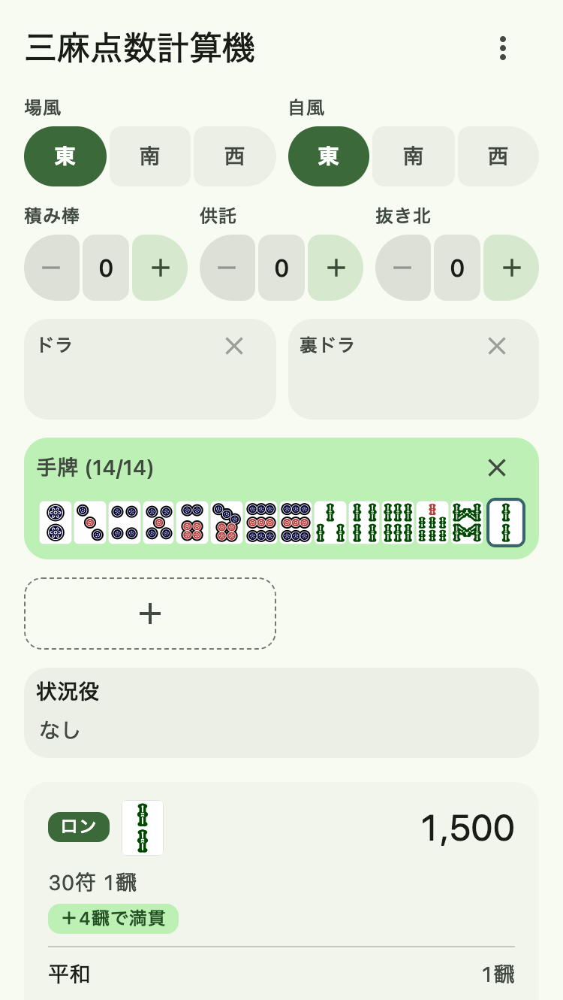
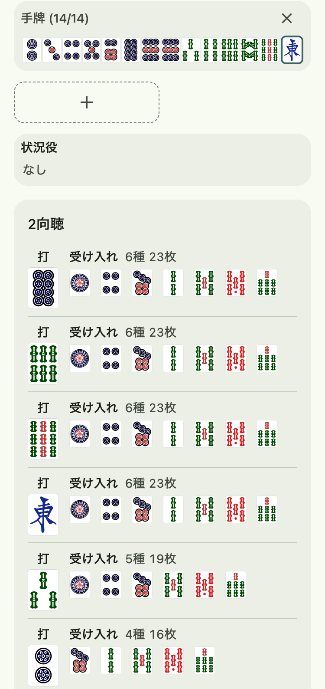

# 三麻点数計算機 (mj-3player-calc)

三人麻雀に特化したスマホ向けの点数計算機（PWA）です。和了形・聴牌形では役と打点を、それ以外では向聴数と何切るを表示します。

## 公開 URL

https://bluekurage119.github.io/mj-3player-calc/

## スクリーンショット

 

画像はイメージです。

## できること

- 和了形の役・飜・符・点数（ロン・ツモ）の計算
- 聴牌時の和了牌ごとの役と点数の表示
- 向聴数・有効牌の表示と、何切る（切る牌ごとの向聴数と受け入れ）
- 三人麻雀のルール設定（ツモ損方式、抜き北、ローカル役など）とプリセット
- 設定に連動した点数計算表の表示
- 和了結果の共有画像（共有・保存・コピー）
- ホーム画面への追加とオフラインでの利用

## 使い方

手牌・ドラ・裏ドラ・副露の各カードをタップすると画面の下に入力パネルが開き、パレットまたはテンキーで牌を入力できます。入力した牌に応じて和了・聴牌・向聴・何切るの結果が自動で切り替わります。

詳しくはアプリ右上のメニューの「ヘルプ」を参照してください。

## ホーム画面への追加（インストール）

### iOS / iPadOS（Safari）

1. Safari で公開 URL を開きます。
2. 画面下の「共有」ボタンをタップします。
3. 「ホーム画面に追加」を選択して追加します。

### Android（Chrome）

1. Chrome で公開 URL を開きます。
2. 右上のメニューボタンをタップします。
3. 「アプリをインストール」（または「ホーム画面に追加」）を選択して追加します。

## 対応環境

- iOS / iPadOS の Safari、Android の Chrome（いずれも最新版を想定）
- PC のブラウザでも動作しますが、スマートフォン向けの画面構成です。

## ライセンス

[MIT](./LICENSE)。計算コアは livewing.net による mahjong-calc（MIT）に由来します。

第三者素材の権利表示は [CREDITS.md](./CREDITS.md) と [LICENSES/](./LICENSES/) を参照してください。アプリ内の「ヘルプ → ライセンス」でも確認できます。

## 開発者向け

構成・ビルド手順・開発の進め方・デプロイ・リリース手順は [docs/development.md](docs/development.md) を参照してください。
